{style="width: 600px;"}

#Lecture 5 - Root finding II

---

## This week

 * More root finding algorithms
 * Basins of attraction
 * Complex roots and Newton fractals

---

### Handling errors with ValueError

A function can reject unsuitable inputs.

For bisection, the starting bounds must bracket a root.

```python
if f(xd) * f(xu) > 0:
    raise ValueError("Invalid bounds.")
```

`raise ValueError` stops the calculation with a message.

---

### Bisection with an error check

```python
def bisection(f, xd, xu, eps):
    if f(xd) * f(xu) > 0:
        raise ValueError("Bounds must bracket a root.")
    while xu - xd > eps:
        xmid = (xd + xu) / 2
        if f(xmid) == 0:
            return xmid
        if f(xd) * f(xmid) <= 0:
            xu = xmid
        else:
            xd = xmid
    return (xd + xu) / 2
```

---

### Lambda functions

A `lambda` creates a small function from a **single expression**:

```python
lambda x: x - 1
```

Here, `x` is the input and `x - 1` is the returned value.

Use this when passing a short function directly to another function.

A lambda cannot contain the loops and statements in our `bisection` function.

---

### With and without lambda

Find a root of $f(x) = x - 1$.

```python
# Without lambda
def f(x):
    return x - 1

root = bisection(f, 0, 3, 1e-6)

# With lambda
root = bisection(lambda x: x - 1, 0, 3, 1e-6)
```

Both calls give the same root estimate: approximately 1.

---

### Animations

Find the two Python files for Week 5:

* [bisection_steps.py](../../static/code/week5/bisection_steps.py)
* [newton_raphson_steps.py](../../static/code/week5/newton_raphson_steps.py)

**Read each script, then run it.** Change `NUMBER_OF_STEPS` and run it again.

Our Python programs are becoming more complex: we now combine **loops** to repeat calculations, **if statements** to make decisions, and **Matplotlib** to display each step.

Can you identify these three parts in each script and explain how they work together?

---

## Challenge: a very flat root

Try $f(x) = (x-1)^7$ with both methods. Run **5 steps**, then **10**.

```python
def f(x):
    return (x - 1)**7
def derivative(x):
    return 7 * (x - 1)**6
```

* **Bisection:** `LEFT = 0.0`, `RIGHT = 3.0`.
* **Newton-Raphson:** `STARTING_X = 2.25`.
* Compare $|x-1|$ with $|f(x)|$. Does small $|f(x)|$ mean an accurate root?

---

## Challenge: an apparent root that isn't one

Try $f(x) = 1/x$ with both methods. Run **5 steps**, then **10**.

```python
def f(x):
    return 1 / x
def derivative(x):
    return -1 / x**2
```

* **Bisection:** `LEFT = -1.0`, `RIGHT = 2.0`.
* **Newton-Raphson:** `STARTING_X = 1.0`.
* Where do $x$ and $f(x)$ go? Is there a root? Which bisection assumption fails?

---

### The Secant method

A secant line, also simply called a secant, is a line passing through two points of a curve. We can use secants to estimate roots as follows:

* Start with two initial guesses $x_0$ and $x_1$. 

* Find the intersection of the secant between $x_0$ and $x_1$ and the $x$ axis.

* Define $x_2$ to be this intersection.

* Find the intersection of the secant between $x_1$ and $x_2$ and the $x$ axis.

* Repeat until the value $x_{n-1} - x_n$ converges sufficiently.

---

<div class="slideshow-container">
  <div class="mySlides">
    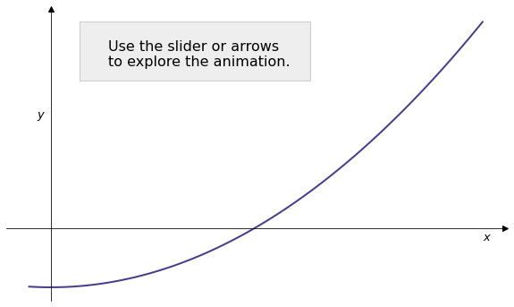
    <!--<div class="text">Caption Text</div>-->
  </div>
  <div class="mySlides">
    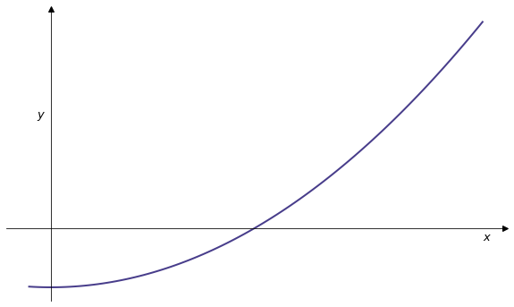
  </div>
  <div class="mySlides">
    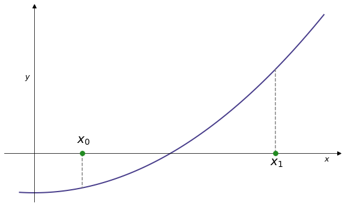
  </div>
  <div class="mySlides">
    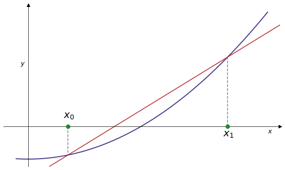
  </div>
  <div class="mySlides">
    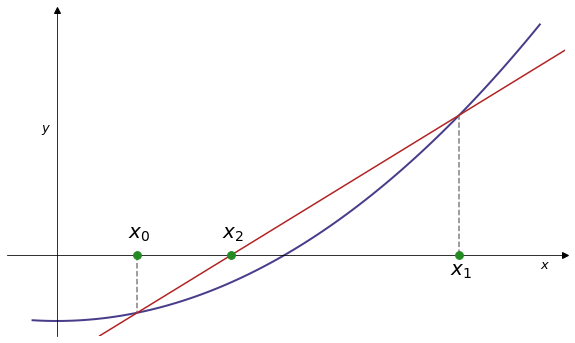
  </div>   
  <div class="mySlides">
    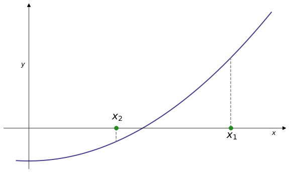
  </div>  
  <div class="mySlides">
    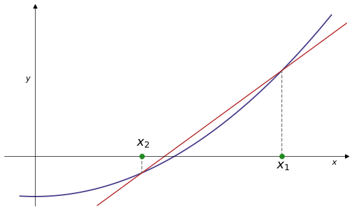
  </div>  
  <div class="mySlides">
    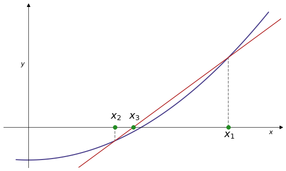
  </div>  
  <div class="mySlides">
    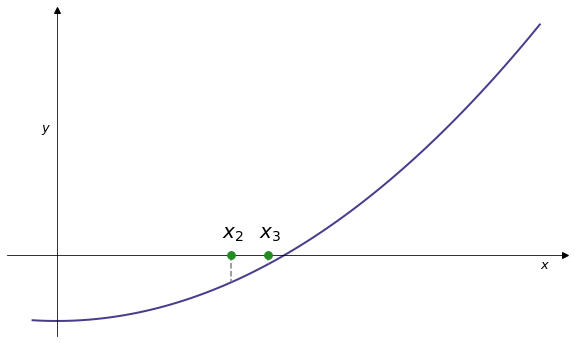
  </div>  
  <div class="mySlides">
    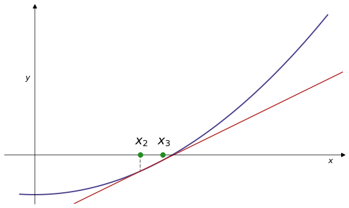
  </div>
  <div class="mySlides">
    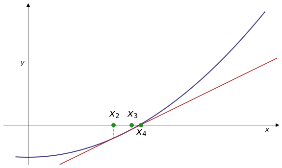
  </div>  
  <div class="mySlides">
    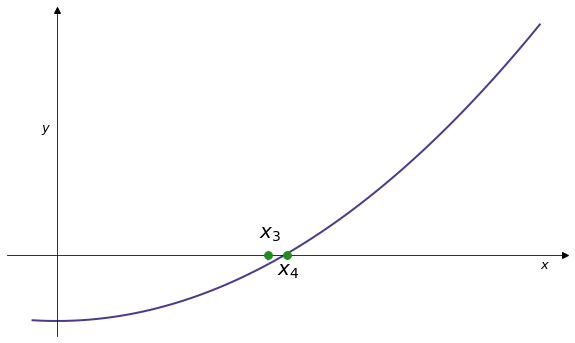
  </div>           
</div>
<br>

<div class="range-slider-container">
  <div class="go-left" onclick="plusDivs(-1)">&#10094;</div>
  <input type="range" class="range-slider" id="slider" min="1" max="12" value="1" step="1">
  <div class="go-right" onclick="plusDivs(1)">&#10095;</div>
</div>


<script>
let slideIndex = 1;
showSlides(slideIndex);

let slider = document.getElementById("slider");

slider.addEventListener("input", function() {
  showSlides(parseInt(slider.value));
});

function plusDivs(n) {
    showSlides(slideIndex += n);
    slider.value = parseInt(slider.value) + n
}

function currentDiv(n) {
  showSlides(slideIndex = n);
}

function showSlides(n) {
  let i;
  let slides = document.getElementsByClassName("mySlides");
  let slidesnext = document.getElementsByClassName("go-right")[0];
  let slidesprevious = document.getElementsByClassName("go-left")[0];

  if (n > slides.length) {slideIndex = 1}    
  if (n < 1) {slideIndex = slides.length}
  for (i = 0; i < slides.length; i++) {
    slides[i].style.display = "none";  
  }
  slideIndex = n; 
  slides[slideIndex-1].style.display = "block";  
  slidesnext.style.display = "block";
  slidesprevious.style.display = "block";
  if (n == 1){slidesprevious.style.display = "none";}
  if (n == 12){slidesnext.style.display = "none";}

}
</script>


---

## Implementing the secant method

By considering the formulae for the secants between $x_{n-1}$ and $x_n$ we obtain the recursive formula

$$ x_{n}=x_{n-1}-f(x_{n-1}){\frac {x_{n-1}-x_{n-2}}{f(x_{n-1})-f(x_{n-2})}} $$

Open [secant_animation.py](../../static/code/week5/secant_animation.py).

Replace `next_x = None` in **STUDENT TASK** using this formula.

In the code, `x0` is $x_{n-2}$ and `x1` is $x_{n-1}$. Run 5 steps.

---

## Secant method: solution

Replace `next_x = None` with:

```python
next_x = x1 - f1 * (x1 - x0) / (f1 - f0)
```

The script already calculates `f0 = f(x0)` and `f1 = f(x1)`.

After plotting, it moves the estimates along:

```python
x0 = x1
x1 = next_x
```

Run [secant_solution.py](../../static/code/week5/secant_solution.py) to compare.

---

## Comparing root finding methods

We've now seen three root finding methods. It is natural to ask which method is best in various situations:

* Bisection: converges for a continuous function when the starting interval brackets a root.
* Newton-Raphson: generally faster, but requires computation of derivative $f'$.
* Secant: also generally faster than bisection, but is not guaranteed to converge for continuous functions.

---

## NumPy `roots`

The NumPy function `roots` will find roots of **a polynomial**.

E.g. for  $f(x) = x^3 + x^2 + x - 3$ we have

```runnable lang="python"
import numpy as np
p = [1,1,1,-3]
r = np.roots(p)
print(r)
```

---

## SciPy `fsolve`

SciPy provides a function `fsolve`, part of `scipy.optimize`. This will find a root of a function given an initial estimate.

```runnable lang="python"
import scipy.optimize as opt
import numpy as np

def func(x):
    return  np.sin(x)

r = opt.fsolve(func, 3)
print(r)

# Or using a lambda function
# r = opt.fsolve(lambda x: np.sin(x), 3)
```

----

## Newton-Raphson sensitivity

The use of the tangent to find the next estimate means that the Newton-Raphson method is (extremely) sensitive to initial conditions.

This is most apparent for functions with infinitely many roots e.g. $f(x)=\sin(x)$.

---

{width=55%}

```python
r,n=newraph(lambda x:np.sin(x),lambda x:np.cos(x),2.0,1e-8)
print("root found at {} after {} iterations".format(r,n))
```
```output
root found at 3.1415926536808043 after 5 iterations
```

---


{width=55%}

```python
r,n=newraph(lambda x:np.sin(x),lambda x:np.cos(x),1.8,1e-8)
print("root found at {} after {} iterations".format(r,n))
```
```output
root found at 6.283185301417648 after 3 iterations
```

---


{width=55%}

```python
r,n=newraph(lambda x:np.sin(x),lambda x:np.cos(x),1.6,1e-8)
print("root found at {} after {} iterations".format(r,n))
```
```output
root found at 31.41592653589652 after 7 iterations
```

---


{width=55%}

```python
r,n=newraph(lambda x:np.sin(x),lambda x:np.cos(x),1.57,1e-8)
print("root found at {} after {} iterations".format(r,n))
```
```output
root found at -1253.4954687820234 after 4 iterations
```


---

## Basins of attraction


Consider the function

$$ f(z) = z^4 - 1$$


```runnable lang="python"
import numpy as np
p = [1,0,0,0,-1]
r = np.roots(p)
print(r)
```

---

The following diagram shows which root is found by the Newton-Raphson method given starting values $z_0 = a+bi$ with $a$ and $b$ in $[-1,1]$

{width=80%}

---

{width="60%"}

The material sketched in this lecture is covered in greater detail in Handout 5.
